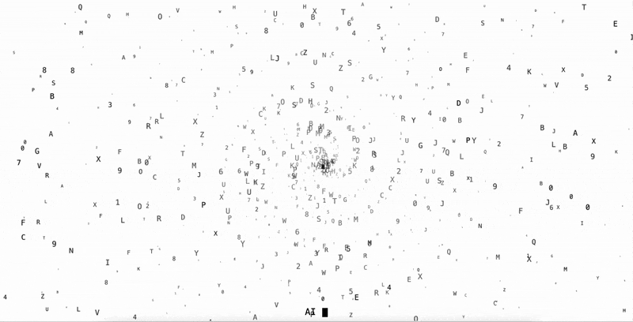

## About

I have a graduate degree in Computer Science. My research was focused on using RAG to improve code completion in private codebases. Previously, I worked as a Software Engineer at Odessa Inc.

## Experience
**Odessa Inc. - Software Engineer II**  
I worked on the core data migration infrastructure and internal developer tooling, contributing across performance optimization, product features, and production fixes.

## Projects

See my **[Github profile](https://github.com/nithinbharathi)** for my open-sourced code. Here are a few of my recent projects:

- **[Character level language model](https://github.com/nithinbharathi/rapgpt)** trained from scratch for rap generation
- **[linear algebra package for Java](https://github.com/nithinbharathi/JMatrix)**  
- An in-memory **[key-value store](https://github.com/nithinbharathi/kv_store)**
- **[reverse automatic differentiation engine](https://github.com/nithinbharathi/Scalargrad)** for scalar arithmetic

## Misc Links
The following are a collection of technical links that I have found to be interesting.

- Jeff Dean's talk on **[google's infrastructure](https://www.youtube.com/watch?v=modXC5IWTJI)** and techniques for **[reducing rapid response times in large scale distributed systems](https://www.youtube.com/watch?v=1-3Ahy7Fxsc)**.
- **[Distributed Systems](https://www.youtube.com/watch?v=cQP8WApzIQQ&list=PL4YhK0pT0ZhXTRSAYHAgBcJkhlM2hlhw3)**
- **[Performance Engineering of Software Systems](https://www.youtube.com/watch?v=o7h_sYMk_oc&list=PLUl4u3cNGP63VIBQVWguXxZZi0566y7Wf)** 
- **[LSM](https://engineering.linkedin.com/distributed-systems/log-what-every-software-engineer-should-know-about-real-time-datas-unifying)**: Everything you will need to understand about the widely used Log Structured Merge Trees.
- Andrej Karpathy's wonderful **[Neural Network: Zero to Hero collection](https://www.youtube.com/playlist?list=PLAqhIrjkxbuWI23v9cThsA9GvCAUhRvKZ)**. I would highly recommend this playlist to anyone looking to get started with deep learning.

<!--## Publications

- **[Feb. 2020]** Our paper about incremental learning is accepted to CVPR 2020.
- **[Feb. 2020]** We will host the ACM Multimedia Asia 2020 conference in Singapore!
- **[Sept. 2019]** Our paper about few-shot learning is accepted to NeurIPS 2019.
- **[Mar. 2019]** Our paper about few-shot learning is accepted to CVPR 2019.
-->

<!---->
